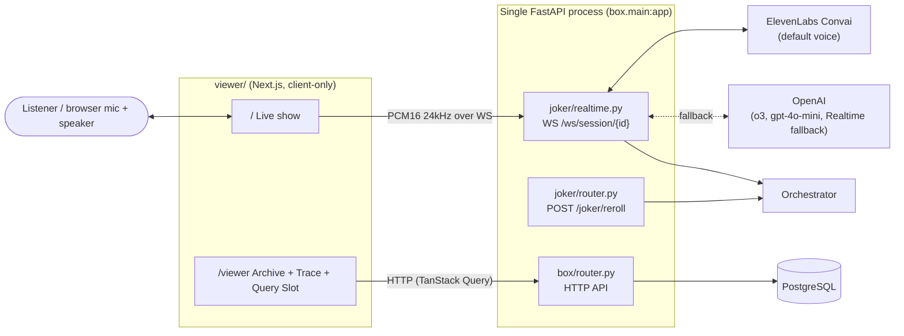
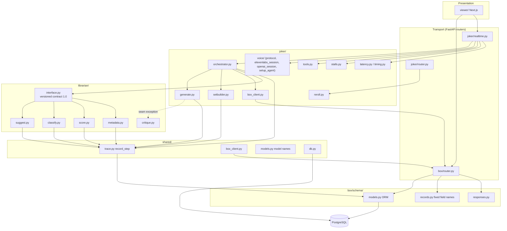
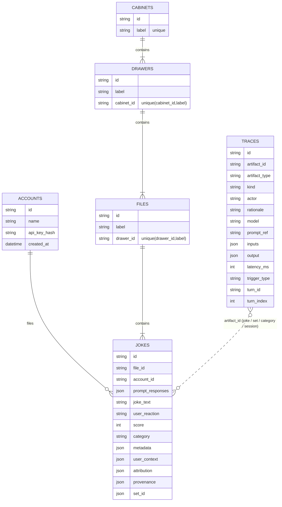
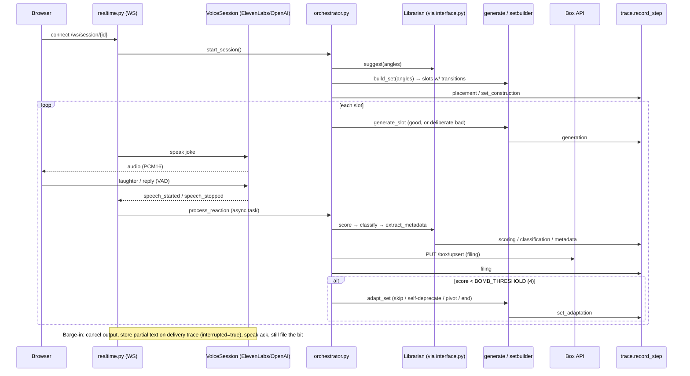

# Jokebox Architecture

Jokebox is an AI stand-up comedian. It performs over live voice, records how each
joke lands, files the joke into a strict taxonomy, and keeps a decision trace so
every choice can be explained.

## 1. System context



There is **one backend** (FastAPI) and a **client-only** Next.js frontend. The
frontend never uses server components for data, server actions, or Next API routes.

## 2. The four components

| Component | Directory | Responsibility | Must not |
|---|---|---|---|
| **Box** | `box/` | Archive API: hierarchy, upsert, queries, accounts, compliance, export, traces | Infer, default, or repair a path |
| **Librarian** | `librarian/` | All judgment: suggest angles, classify genre, score reaction, extract metadata, critique | Import `joker.*` |
| **Joker** | `joker/` | Voice loop, set construction, generation, barge-in, filing via Box HTTP | Own taxonomy decisions |
| **Viewer** | `viewer/` | Transparency UI: tree, joke detail, trace, exports | Compute genres or scores |

Supporting packages: `shared/` (db, trace, models, Box client), `prompts/`
(versioned prompt files), `alembic/` (migrations), `scripts/` (seed, voice client).

## 3. Layered module map



### Rules the structure enforces
- Joker and Librarian talk only through `librarian/interface.py` (versioned `1.0`).
- The Box is dumb storage; classification intelligence is only in the Librarian.
- Every model call goes through `shared/trace.py::record_step` (`rationale` has no default).
- Known seam deviations: `joker/generate.py` imports `librarian.critique`; `librarian/classify.py`
  writes new File rows with SQL (`_create_category`) rather than over HTTP.

## 4. Data model



Hierarchy: **Box > Cabinet > Drawer > File > Joke**; every level needs more than one
child. Compliance is computed live in `GET /compliance` (no stored flag). Traces are
joined to a joke via several artifact ids (`joke_*`, set id, `category:{label}`,
session rows matched on `joke_text`) in `_traces_for_joke`.

Migrations (`alembic/versions/`): 001 initial schema, 002 accounts, 003 enriched user
context, 004 account API key, 005 hash API key, 006 trace turns.

## 5. Box HTTP surface (`box/router.py`)

| Area | Routes |
|---|---|
| Health / accounts | `GET /health`, `POST/GET /accounts`, `GET /accounts/{id}` |
| Write (Bearer required) | `PUT /box/upsert`, `PUT /jokes/{id}` |
| Hierarchy reads | `GET /box`, `/box/{cab}/{drw}/{file}`, `/cabinets[/id[/counts]]`, `/drawers[...]`, `/files[...]` |
| Jokes | `GET /jokes/top`, `GET /jokes/{id}`, `GET /jokes/{id}/trace` |
| Traces | `GET /traces/{artifact_id}` |
| Genres | `GET /genres/coverage`, `GET /genres/{genre}/funniest` |
| Whole archive | `GET /export`, `GET /compliance`, `GET /counts` |
| Joker | `POST /joker/reroll` (`joker/router.py`) |
| Voice | `WS /ws/session/{session_id}` (not in OpenAPI) |

Auth: `require_account` resolves `Authorization: Bearer jbx_…` by `sha256` hash.
`attribution.account` is overwritten from the resolved account (cannot be spoofed).
Upsert: `INSERT … ON CONFLICT DO NOTHING` for cabinet/drawer/file, then select, one
commit at the end, so concurrent writers to the same path do not duplicate levels.

## 6. Live show pipeline



Details:
- **Voice**: `joker/voice/protocol.py` defines `VoiceSession`/`VoiceCallbacks`;
  `elevenlabs_session.py` (default) and `openai_session.py` (fallback) implement it.
  `VOICE_PROVIDER` selects. `setup_agent.py` configures the ElevenLabs agent.
- **Tools exposed to the voice agent** (`joker/tools.py`): `funniest_in_genre`, `write_fresh_bit`.
- **Stalls** (`joker/stalls.py`, `prompts/stalls.yaml`): in-character filler while models run.
- **Latency** (`joker/latency.py`, `timing.py`): per-stage p50/p95 flushed to `docs/TOPOGRAPHY.md`.
- **Reroll** (`joker/reroll.py`): files the rejected joke, generates a tone-level-darker
  replacement, or returns a refusal line at tone 3.
- **Turns**: `bind_turn` (ContextVar) stamps `trigger_type` (`cold_open`, `user_request`,
  `set_continuation`, `reroll`, `barge_in_recovery`, `query_slot`) onto subsequent traces.

## 7. Librarian contract (`librarian/interface.py`)

| Direction | Types |
|---|---|
| Joker → Librarian | `SuggestionRequest` (user context, history, taxonomy snapshot, preferred tone, recent critiques), `ClassificationRequest` |
| Librarian → Joker | ranked `Angle`s, `ClassificationResponse` (category, `is_new`, justification, three-label path), integer score, metadata |

Facades: `suggest`, `classify`, `score`, `extract_metadata`. `assert_compatible_version`
rejects mismatched contract versions. `critique.py` produces the mechanism sentence
stored on `metadata.critique` and fed back into generate/suggest through a session buffer.

## 8. Models and prompts

Defaults in `shared/models.py`, overridable via env vars of the same name.

| Task | Default |
|---|---|
| classify, generate (good), setbuilder | `o3` |
| generate (bad), suggest, score, metadata | `gpt-4o-mini` |
| Voice | ElevenLabs Convai (default); OpenAI Realtime (fallback) |

`prompts/` holds versioned files (`*_v1.txt` …) for classify, generate, score, suggest,
setbuilder, metadata, realtime, plus personas, tone levels (1 standard, 2 edgier,
3 darkest), `shapes_v1.md` few-shot shapes, and `stalls.yaml`. Traces record
`prompt_ref` so a decision points back to the exact prompt.

## 9. Viewer (`viewer/`)

Next.js App Router, TypeScript, Tailwind, TanStack Query. All data from the Box.

```
app/
  layout.tsx, providers.tsx       QueryClient provider
  page.tsx                        Live show (mic, host, critic column, transcript)
  viewer/page.tsx                 Archive (tree, joke detail, trace, export, Query Slot)
components/
  Tree, JokeDetail, Trace, TurnHeader, ComplianceBar, Export, QuerySlot
  show/ HostFigure, CriticFigure, CriticColumn, LibrarianCard, MicControl, TranscriptFeed
lib/
  api.ts          HTTP client for Box (NEXT_PUBLIC_BOX_URL)
  types.ts        mirrors box/schema/records.py
  useShowSession  WebSocket session hook
  turns.ts        groups traces by turn
  archive.ts      tree/browse helpers
```

## 10. Testing and ops

- Tests: `pytest`, mostly in `box/tests/` (Box API, concurrency, auth, traces,
  Librarian, Joker). A separate `TEST_DATABASE_URL` is used.
- Config: `.env` (`DATABASE_URL`, `OPENAI_API_KEY`, `ELEVENLABS_API_KEY`, `BOX_API_KEY`),
  `viewer/.env.local` (`NEXT_PUBLIC_BOX_URL`).
- Run: `uvicorn box.main:app --port 8000` and `cd viewer && npm run dev`.
- Decisions log: `docs/DECISIONS.md`; latency table: `docs/TOPOGRAPHY.md`.
